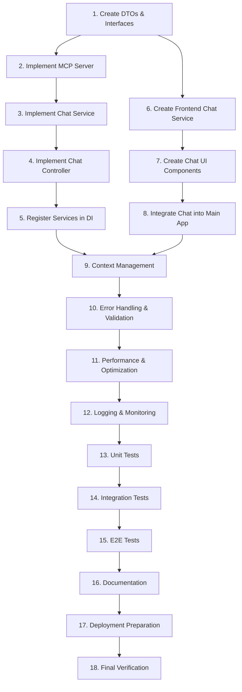

# Implementation Plan

## Overview

This implementation plan breaks down the AI Chatbot CRUD feature into logical, independently testable tasks. The plan is organized into 6 phases:

1. **Foundation & Data Models**: DTOs, interfaces, and core data structures
2. **Backend Services**: MCP Server (intent detection) and Chat Service (business logic)
3. **Frontend Implementation**: React UI components and chat interface
4. **Advanced Features**: Context management, follow-ups, and optimization
5. **Testing**: Unit, integration, and E2E tests
6. **Documentation & Deployment**: Guides, API docs, and deployment preparation

Each task is designed to be:
- **Independently testable**: Can be verified without waiting for other tasks
- **Properly sequenced**: Dependencies are clearly identified
- **Requirement-mapped**: Each task references specific requirements from design.md

**Total Estimated Effort:** 16-22 days (3-4 weeks with 1 developer)

---

## Task Dependency Graph



```json
{
  "waves": [
    {
      "name": "Wave 1: Foundation",
      "tasks": ["1.1", "1.2", "1.3", "1.4", "1.5", "1.6", "1.7", "1.8", "1.9", "1.10"]
    },
    {
      "name": "Wave 2: MCP Server & Frontend Service",
      "tasks": ["2.1", "2.2", "2.3", "2.4", "2.5", "2.6", "2.7", "2.8", "2.9", "2.10", "2.11", "6.1", "6.2"],
      "dependsOn": ["Wave 1: Foundation"]
    },
    {
      "name": "Wave 3: Chat Service & Frontend UI",
      "tasks": ["3.1", "3.2", "3.3", "3.4", "3.5", "3.6", "3.7", "3.8", "3.9", "3.10", "3.11", "7.1", "7.2", "7.3", "7.4", "7.5", "7.6", "7.7", "7.8"],
      "dependsOn": ["Wave 2: MCP Server & Frontend Service"]
    },
    {
      "name": "Wave 4: Controller & Integration",
      "tasks": ["4.1", "4.2", "4.3", "4.4", "5.1", "5.2", "5.3", "8.1", "8.2", "8.3"],
      "dependsOn": ["Wave 3: Chat Service & Frontend UI"]
    },
    {
      "name": "Wave 5: Advanced Features",
      "tasks": ["9.1", "9.2", "9.3", "10.1", "10.2", "10.3", "10.4", "11.1", "11.2", "11.3", "11.4", "12.1", "12.2", "12.3"],
      "dependsOn": ["Wave 4: Controller & Integration"]
    },
    {
      "name": "Wave 6: Testing",
      "tasks": ["13.1", "13.2", "13.3", "13.4", "14.1", "14.2", "14.3", "14.4", "14.5", "14.6", "15.1", "15.2", "15.3"],
      "dependsOn": ["Wave 5: Advanced Features"]
    },
    {
      "name": "Wave 7: Deployment",
      "tasks": ["16.1", "16.2", "16.3", "16.4", "17.1", "17.2", "17.3", "18"],
      "dependsOn": ["Wave 6: Testing"]
    }
  ]
}
```

**Critical Path:** 1 → 2 → 3 → 4 → 5 → 9 → 10 → 13 → 14 → 18

**Parallel Work Opportunities:**
- Frontend (tasks 6-8) can start after task 1 completes
- Testing (task 13) can be written alongside implementation
- Documentation (task 16) can be written throughout

---

## Tasks

### Phase 1: Foundation & Data Models

### 1. Create DTOs and Interfaces

- [ ] 1.1 Create ChatRequest DTO
  - Create `EmployeeManagement.Application/DTOs/ChatRequest.cs`
  - Properties: Message (string), SessionId (string), Context (Dictionary<string, object>)
  - Add validation attributes (Required for Message)
  - Add XML documentation
  - _Requirements: 2.2_

- [ ] 1.2 Create ChatResponse DTO
  - Create `EmployeeManagement.Application/DTOs/ChatResponse.cs`
  - Properties: ResponseText, Type (enum), Data (object), UpdatedContext
  - Add serialization attributes for JSON
  - Add XML documentation
  - _Requirements: 2.2_

- [ ] 1.3 Create ChatResponseType enum
  - Create enum in ChatResponse.cs file
  - Values: SUCCESS, ERROR, CLARIFICATION, INFO, CONFIRMATION
  - Add XML documentation for each value
  - _Requirements: 2.2_

- [ ] 1.4 Create ChatIntent enum
  - Create `EmployeeManagement.Application/Enums/ChatIntent.cs`
  - Values: CREATE_EMPLOYEE, READ_EMPLOYEE, READ_ALL_EMPLOYEES, UPDATE_EMPLOYEE, DELETE_EMPLOYEE, SEARCH_EMPLOYEES, CALCULATE_STATS, CLARIFICATION_NEEDED, UNKNOWN
  - Add XML documentation
  - _Requirements: 2.3_

- [ ] 1.5 Create ChatEntity class
  - Create `EmployeeManagement.Application/DTOs/ChatEntity.cs`
  - Properties: FullName, Email, Department, Salary (nullable), EmployeeId (nullable), SearchQuery
  - Add validation attributes
  - Add XML documentation
  - _Requirements: 2.3_

- [ ] 1.6 Create ChatIntentResult class
  - Create `EmployeeManagement.Application/DTOs/ChatIntentResult.cs`
  - Properties: Intent (ChatIntent), Entities (ChatEntity), Confidence (decimal), OriginalMessage (string)
  - Add XML documentation
  - _Requirements: 2.3_

- [ ] 1.7 Create ChatSession class
  - Create `EmployeeManagement.Application/Models/ChatSession.cs`
  - Properties: SessionId, CreatedAt, LastActivity, MessageHistory (Queue<ChatMessage>), Context (Dictionary)
  - Add method for updating LastActivity
  - Add method for managing message history size (max 50 messages)
  - _Requirements: 5_

- [ ] 1.8 Create ChatMessage class
  - Create `EmployeeManagement.Application/Models/ChatMessage.cs`
  - Properties: Id, SessionId, Role (User/Bot), Content, Timestamp
  - Add XML documentation
  - _Requirements: 5_

- [ ] 1.9 Create IChatMcpServer interface
  - Create `EmployeeManagement.Application/Interfaces/IChatMcpServer.cs`
  - Method: Task<ChatIntentResult> AnalyzeMessageAsync(string message)
  - Add XML documentation
  - _Requirements: 2.3_

- [ ] 1.10 Create IChatService interface
  - Create `EmployeeManagement.Application/Interfaces/IChatService.cs`
  - Method: Task<ChatResponse> ProcessMessageAsync(string userMessage, string sessionId, Dictionary<string, object> context)
  - Add XML documentation
  - _Requirements: 2.4_

### 2. Implement MCP Server (Intent Detection)

- [ ] 2.1 Create ChatMcpServer skeleton
  - Create `EmployeeManagement.Infrastructure/MCP/ChatMcpServer.cs`
  - Implement IChatMcpServer interface
  - Add constructor with ILogger dependency
  - Add private fields for keyword mappings
  - _Requirements: 2.3_

- [ ] 2.2 Implement intent keyword mappings
  - Create _intentKeywords dictionary with all intents and their keywords
  - CREATE_EMPLOYEE: "add", "create", "new employee", "hire", "onboard"
  - UPDATE_EMPLOYEE: "update", "modify", "change", "edit", "set"
  - DELETE_EMPLOYEE: "delete", "remove", "fire", "dismiss"
  - READ_EMPLOYEE: "show", "get", "find", "info", "details", "who is"
  - READ_ALL_EMPLOYEES: "list", "show all", "display", "all employees"
  - SEARCH_EMPLOYEES: "search", "find employees", "filter", "department"
  - CALCULATE_STATS: "average", "salary", "total", "count", "how many"
  - _Requirements: 2.3_

- [ ] 2.3 Implement DetectIntent method
  - Convert message to lowercase
  - Iterate through intent keywords
  - Score each intent based on keyword matches
  - Return intent with highest score
  - Return UNKNOWN if score below threshold (0.3)
  - Add logging for detected intent and confidence
  - _Requirements: 2.3_

- [ ] 2.4 Implement ExtractFullName method
  - Use regex patterns to extract names
  - Handle formats: "add John Smith", "John Smith, email", "name: John"
  - Return null if no name detected
  - Capitalize first letters
  - _Requirements: 2.3_

- [ ] 2.5 Implement ExtractEmail method
  - Use regex pattern for email validation
  - Pattern: `[a-zA-Z0-9._%+-]+@[a-zA-Z0-9.-]+\.[a-zA-Z]{2,}`
  - Return null if no email found
  - Validate email format
  - _Requirements: 2.3_

- [ ] 2.6 Implement ExtractDepartment method
  - Define known departments: Engineering, Sales, HR, Marketing, Finance, Operations
  - Search for department names (case-insensitive)
  - Return null if no department found
  - Handle abbreviations (Eng→Engineering, HR→HR)
  - _Requirements: 2.3_

- [ ] 2.7 Implement ExtractSalary method
  - Use regex to find numeric values with optional $ or "salary"
  - Patterns: "$50000", "salary 50000", "50k", "50K"
  - Convert "k" notation to thousands (50k → 50000)
  - Return null if no salary found
  - Validate reasonable range (1000-1000000)
  - _Requirements: 2.3_

- [ ] 2.8 Implement ExtractEmployeeId method
  - Use regex to find "id" followed by number
  - Patterns: "id 5", "employee #5", "#5"
  - Return null if no ID found
  - _Requirements: 2.3_

- [ ] 2.9 Implement ExtractSearchQuery method
  - Extract query for SEARCH_EMPLOYEES intent
  - Handle department filters
  - Handle name searches
  - Handle partial matches
  - _Requirements: 2.3_

- [ ] 2.10 Implement CalculateConfidence method
  - Calculate confidence based on:
    - Intent match strength (40%)
    - Number of entities extracted (30%)
    - Required entities present (30%)
  - Return value between 0.0 and 1.0
  - Add detailed logging
  - _Requirements: 2.3_

- [ ] 2.11 Implement main AnalyzeMessageAsync method
  - Call DetectIntent
  - Call all Extract methods based on intent
  - Call CalculateConfidence
  - Return ChatIntentResult with all data
  - Add comprehensive logging
  - Handle exceptions gracefully
  - _Requirements: 2.3_

### 3. Implement Chat Service (Business Logic)

- [ ] 3.1 Create ChatService skeleton
  - Create `EmployeeManagement.Application/Services/ChatService.cs`
  - Implement IChatService interface
  - Add constructor with dependencies: IChatMcpServer, IEmployeeService, ILogger
  - Add private field for session storage: ConcurrentDictionary<string, ChatSession>
  - Add session timeout configuration (default: 30 minutes)
  - _Requirements: 2.4_

- [ ] 3.2 Implement ProcessMessageAsync entry point
  - Validate input parameters (message not empty, sessionId valid)
  - Get or create chat session
  - Update session LastActivity
  - Add user message to history
  - Call AnalyzeMessageAsync from MCP server
  - Validate confidence threshold (0.6)
  - Route to appropriate handler based on intent
  - Add bot response to history
  - Return ChatResponse
  - Add comprehensive error handling and logging
  - _Requirements: 2.4_

- [ ] 3.3 Implement session management methods
  - GetOrCreateSession(string sessionId)
  - CleanupExpiredSessions() - remove sessions older than timeout
  - AddMessageToHistory(string sessionId, ChatMessage message)
  - GetSessionContext(string sessionId)
  - UpdateSessionContext(string sessionId, Dictionary<string, object> context)
  - _Requirements: 5_

- [ ] 3.4 Implement HandleCreateEmployee method
  - Extract required entities: FullName, Email, Department, Salary
  - Validate all required fields present
  - If missing fields, return CLARIFICATION response with missing field list
  - Create CreateEmployeeDto
  - Call IEmployeeService.CreateAsync
  - Handle duplicate email error (catch exception)
  - Handle validation errors
  - Format success response with employee details
  - Return ChatResponse with SUCCESS type
  - _Requirements: 1.1, 1.2, 1.3, 2.4_

- [ ] 3.5 Implement HandleReadEmployee method
  - Extract FullName or EmployeeId
  - If missing, return CLARIFICATION response
  - Search employees by name or ID
  - If multiple matches, return CLARIFICATION with list of matches
  - If not found, return ERROR response with suggestions
  - Format employee details in response
  - Update session context with selected employee
  - Return ChatResponse with INFO type
  - _Requirements: 1.4, 2.4_

- [ ] 3.6 Implement HandleReadAllEmployees method
  - Call IEmployeeService.GetAllAsync()
  - Format employee list for display
  - If list is long (>10), show summary + offer pagination
  - Update session context with results
  - Return ChatResponse with INFO type and employee data
  - _Requirements: 1.5, 2.4_

- [ ] 3.7 Implement HandleUpdateEmployee method
  - Extract EmployeeId or FullName
  - If missing, check session context for selectedEmployee
  - Extract fields to update (Salary, Department, Email, Name)
  - If no fields specified, return CLARIFICATION
  - Get existing employee data
  - Build update DTO with changes
  - Call IEmployeeService.UpdateAsync
  - Show before/after comparison in response
  - Return ChatResponse with SUCCESS type
  - _Requirements: 1.6, 1.7, 2.4_

- [ ] 3.8 Implement HandleDeleteEmployee method
  - Extract EmployeeId or FullName
  - Search for employee
  - If not found, return ERROR response
  - Check if deletion is already confirmed in context
  - If not confirmed, return CONFIRMATION response with employee details
  - If confirmed, call IEmployeeService.DeleteAsync
  - Clear confirmation from context
  - Return ChatResponse with SUCCESS type
  - _Requirements: 1.8, 1.9, 2.4_

- [ ] 3.9 Implement HandleSearchEmployees method
  - Extract search parameters (Department, Name, Salary range)
  - Call IEmployeeService with filters
  - Format search results
  - Update session context with results and search criteria
  - Return ChatResponse with INFO type
  - _Requirements: 1.10, 2.4_

- [ ] 3.10 Implement HandleCalculateStats method
  - Determine stat type: average salary, count, total salary
  - Use context results if available (from previous search)
  - Otherwise, get all employees
  - Calculate requested statistic
  - Format response with clear explanation
  - Return ChatResponse with INFO type
  - _Requirements: 1.11, 2.4_

- [ ] 3.11 Implement helper methods
  - ClarificationResponse(string message)
  - ErrorResponse(string message, object? data = null)
  - SuccessResponse(string message, object? data = null)
  - FormatEmployeeDetails(EmployeeDto employee)
  - FormatEmployeeList(List<EmployeeDto> employees)
  - FindEmployeeByName(string name, List<EmployeeDto> employees)
  - ValidateSalaryRange(decimal? salary)
  - _Requirements: 2.4, 6_

### 4. Implement Chat Controller

- [ ] 4.1 Create ChatController
  - Create `EmployeeManagement.Api/Controllers/ChatController.cs`
  - Inherit from ControllerBase
  - Add [ApiController] and [Route("api/[controller]")] attributes
  - Add constructor with IChatService and ILogger dependencies
  - Add XML documentation
  - _Requirements: 2.2_

- [ ] 4.2 Implement POST /api/chat/message endpoint
  - Add [HttpPost("message")] attribute
  - Parameter: [FromBody] ChatRequest request
  - Return type: ActionResult<ChatResponse>
  - Validate request model
  - Generate sessionId if not provided
  - Call IChatService.ProcessMessageAsync
  - Handle exceptions and return appropriate HTTP status codes
  - Add logging for requests and responses
  - _Requirements: 1.12, 2.2_

- [ ] 4.3 Add model validation
  - Validate ChatRequest.Message is not null or empty
  - Validate SessionId format (GUID)
  - Return 400 BadRequest for validation errors
  - Include validation error details in response
  - _Requirements: 2.2_

- [ ] 4.4 Add error handling middleware integration
  - Ensure controller exceptions are caught by global exception handler
  - Return consistent error format
  - Log all errors with correlation IDs
  - _Requirements: 6_

### 5. Register Services in DI Container

- [ ] 5.1 Register MCP Server
  - In `EmployeeManagement.Infrastructure/DependencyInjection.cs`
  - Add `services.AddSingleton<IChatMcpServer, ChatMcpServer>()`
  - Add XML documentation
  - _Requirements: 2.3_

- [ ] 5.2 Register Chat Service
  - In `EmployeeManagement.Application/DependencyInjection.cs`
  - Add `services.AddScoped<IChatService, ChatService>()`
  - Configure session timeout from appsettings
  - Add XML documentation
  - _Requirements: 2.4_

- [ ] 5.3 Add configuration for chat settings
  - In `appsettings.json`, add ChatSettings section
  - SessionTimeoutMinutes (default: 30)
  - MaxMessagesInHistory (default: 50)
  - MinConfidenceThreshold (default: 0.6)
  - _Requirements: 5_

## Phase 2: Frontend Implementation

### 6. Create Chat Service (Frontend)

- [ ] 6.1 Create chatService.ts
  - Create `EmployeeManagement-FE/src/services/chatService.ts`
  - Define API endpoint constant
  - Implement sendMessage function with axios
  - Handle HTTP errors
  - Add request/response TypeScript types
  - _Requirements: 2.1_

- [ ] 6.2 Define TypeScript interfaces
  - ChatRequest interface
  - ChatResponse interface
  - ChatMessage interface
  - ChatResponseType enum
  - _Requirements: 2.1_

### 7. Create Chat UI Components

- [ ] 7.1 Create ChatBot main component
  - Create `EmployeeManagement-FE/src/components/ChatBot.tsx`
  - Props: isOpen, onClose
  - State: messages, isLoading, sessionId, context, inputValue
  - Use useState and useEffect hooks
  - Generate sessionId on mount
  - _Requirements: 1.13, 2.1_

- [ ] 7.2 Implement ChatContainer layout
  - Create container div with glassmorphism styling
  - Position: fixed bottom-right (20px from edges)
  - Width: 400px, Height: 600px on desktop
  - Full screen on mobile
  - z-index: 1000
  - Add slide-in animation
  - _Requirements: 2.1, 7.1_

- [ ] 7.3 Implement ChatHeader component
  - Title: "Employee Assistant"
  - Close button (X) in top-right
  - Styling consistent with app theme
  - _Requirements: 2.1_

- [ ] 7.4 Implement ChatMessages component
  - Scrollable message list
  - Auto-scroll to bottom on new message
  - Display user and bot messages with different styles
  - User messages: right-aligned, blue background
  - Bot messages: left-aligned, gray background
  - Show timestamps
  - Add loading indicator (3 dots animation) when isLoading
  - _Requirements: 2.1_

- [ ] 7.5 Implement message formatting
  - Format employee data as cards or tables
  - Add icons for success/error messages
  - Support markdown in bot responses (optional)
  - Format lists with proper spacing
  - _Requirements: 2.1_

- [ ] 7.6 Implement ChatInput component
  - Textarea for message input
  - Placeholder text: "Ask me to list employees, add new ones, update info..."
  - Send button (paper plane icon)
  - Disable input while isLoading
  - Handle Enter key to send (Shift+Enter for new line)
  - Auto-resize textarea based on content (max 4 lines)
  - _Requirements: 2.1_

- [ ] 7.7 Implement useChat custom hook
  - Create `EmployeeManagement-FE/src/hooks/useChat.ts`
  - Manage messages state
  - Manage sessionId state
  - Manage context state
  - sendMessage function
  - Handle loading state
  - Handle errors
  - _Requirements: 2.1_

- [ ] 7.8 Add chat widget styling
  - Create `EmployeeManagement-FE/src/components/ChatBot.css`
  - Glassmorphism effect: backdrop-filter, rgba colors
  - Responsive design (mobile-first)
  - Smooth animations
  - Hover effects on buttons
  - Custom scrollbar styling
  - _Requirements: 2.1, 7.1_

### 8. Integrate Chat into Main App

- [ ] 8.1 Add chat toggle button to main layout
  - Floating button in bottom-right corner
  - Icon: chat bubble
  - Badge showing "New" or message count
  - Click to toggle chat open/close
  - _Requirements: 7.1_

- [ ] 8.2 Add ChatBot to App.tsx
  - Import ChatBot component
  - Add state for isChatOpen
  - Render ChatBot with isOpen and onClose props
  - Ensure chat appears above all other content
  - _Requirements: 7.1_

- [ ] 8.3 Add keyboard shortcut for chat
  - Listen for Ctrl+K or Cmd+K
  - Toggle chat open/close
  - Show tooltip on hover
  - _Requirements: 7.1_

## Phase 3: Advanced Features & Polish

### 9. Context Management & Follow-ups

- [ ] 9.1 Implement context persistence
  - Store last search results in context
  - Store selected employee in context
  - Store current operation state
  - Clear context on session timeout
  - _Requirements: 5_

- [ ] 9.2 Implement follow-up query handling
  - Detect pronouns: "him", "her", "it", "that one"
  - Resolve references to previous results
  - Handle pagination: "show more", "next page"
  - Handle refinement: "only engineering", "salary above 60k"
  - _Requirements: 5_

- [ ] 9.3 Implement confirmation handling
  - Track pending confirmations in context
  - Match confirmation messages: "yes", "confirm", "proceed"
  - Match rejection messages: "no", "cancel", "stop"
  - Clear confirmation after action or rejection
  - _Requirements: 6_

### 10. Error Handling & Validation

- [ ] 10.1 Add input sanitization
  - Trim whitespace from message
  - Remove special characters that could break parsing
  - Limit message length (max 500 characters)
  - Reject empty messages
  - _Requirements: 6_

- [ ] 10.2 Add retry logic for failed API calls
  - Retry up to 3 times on network errors
  - Exponential backoff (1s, 2s, 4s)
  - Show "Retrying..." message to user
  - Show error after all retries fail
  - _Requirements: 6_

- [ ] 10.3 Improve error messages
  - User-friendly error messages
  - Actionable suggestions
  - Examples of correct format
  - Link to help documentation
  - _Requirements: 6_

- [ ] 10.4 Add validation error handling
  - Catch FluentValidation errors from API
  - Format validation errors clearly
  - Highlight which fields need correction
  - _Requirements: 6_

### 11. Performance & Optimization

- [ ] 11.1 Add response caching
  - Cache employee list for 60 seconds
  - Invalidate cache on CUD operations
  - Use in-memory cache in ChatService
  - _Requirements: 12_

- [ ] 11.2 Optimize intent detection performance
  - Pre-compile regex patterns
  - Cache keyword lookups
  - Add performance logging
  - _Requirements: 12_

- [ ] 11.3 Add request throttling
  - Limit to 10 requests per minute per session
  - Return 429 Too Many Requests if exceeded
  - Show friendly message to user
  - _Requirements: 12_

- [ ] 11.4 Optimize frontend rendering
  - Memoize ChatMessages component
  - Use React.memo for message items
  - Virtualize long message lists (if >50 messages)
  - _Requirements: 12_

### 12. Logging & Monitoring

- [ ] 12.1 Add structured logging in ChatService
  - Log each request with sessionId, intent, confidence
  - Log response times
  - Log errors with full context
  - Use ILogger with proper log levels
  - _Requirements: 6_

- [ ] 12.2 Add structured logging in MCP Server
  - Log intent detection results
  - Log entity extraction results
  - Log confidence calculations
  - _Requirements: 6_

- [ ] 12.3 Add analytics events (optional)
  - Track successful operations
  - Track failed operations
  - Track clarification requests
  - Track average confidence scores
  - _Requirements: 12_

## Phase 4: Testing

### 13. Unit Tests

- [ ] 13.1 Test MCP Server intent detection
  - Test each intent with valid messages
  - Test confidence calculation
  - Test edge cases (empty message, special characters)
  - Assert accuracy >95%
  - _Requirements: 10_

- [ ] 13.2 Test MCP Server entity extraction
  - Test ExtractFullName with various formats
  - Test ExtractEmail with valid/invalid emails
  - Test ExtractDepartment with known departments
  - Test ExtractSalary with various formats ($, k notation)
  - Test ExtractEmployeeId with various formats
  - _Requirements: 10_

- [ ] 13.3 Test ChatService handlers
  - Test HandleCreateEmployee with valid/invalid data
  - Test HandleReadEmployee with found/not found scenarios
  - Test HandleUpdateEmployee with various update scenarios
  - Test HandleDeleteEmployee with confirmation flow
  - Mock IEmployeeService and IChatMcpServer
  - _Requirements: 10_

- [ ] 13.4 Test session management
  - Test session creation
  - Test session timeout cleanup
  - Test message history management
  - Test context updates
  - _Requirements: 10_

### 14. Integration Tests

- [ ] 14.1 Test full chat flow for CREATE
  - Send message: "Add John, john@test.com, Engineering, 70000"
  - Assert employee created in database
  - Assert response type is SUCCESS
  - Assert response contains employee details
  - _Requirements: 10_

- [ ] 14.2 Test full chat flow for READ
  - Create test employee
  - Send message: "Show John Smith"
  - Assert response contains correct employee data
  - _Requirements: 10_

- [ ] 14.3 Test full chat flow for UPDATE
  - Create test employee
  - Send message: "Update John Smith salary to 80000"
  - Assert employee updated in database
  - Assert response shows before/after values
  - _Requirements: 10_

- [ ] 14.4 Test full chat flow for DELETE
  - Create test employee
  - Send message: "Delete John Smith"
  - Assert CONFIRMATION response
  - Send confirmation: "confirm delete John Smith"
  - Assert employee deleted from database
  - _Requirements: 10_

- [ ] 14.5 Test search and context
  - Send message: "Show Engineering employees"
  - Assert response contains filtered list
  - Send follow-up: "Give Alice a raise"
  - Assert update uses context from previous search
  - _Requirements: 10_

- [ ] 14.6 Test error scenarios
  - Test duplicate email error
  - Test invalid employee name
  - Test missing required fields
  - Test API failures
  - _Requirements: 10_

### 15. E2E Tests (Frontend)

- [ ] 15.1 Test chat widget interaction
  - Open chat widget
  - Send message
  - Verify bot response appears
  - Verify loading indicator
  - Close chat widget
  - _Requirements: 10_

- [ ] 15.2 Test message formatting
  - Send create command
  - Verify success message formatting
  - Send list command
  - Verify employee list formatting
  - _Requirements: 10_

- [ ] 15.3 Test error handling UI
  - Trigger network error
  - Verify error message displayed
  - Verify retry option available
  - _Requirements: 10_

## Phase 5: Documentation & Deployment

### 16. Documentation

- [ ] 16.1 Add XML documentation to all public APIs
  - Document all DTOs
  - Document all service interfaces
  - Document controller endpoints
  - _Requirements: N/A_

- [ ] 16.2 Create user guide
  - List of supported commands
  - Examples for each operation
  - Tips for best results
  - Troubleshooting common issues
  - _Requirements: N/A_

- [ ] 16.3 Create API documentation
  - Document chat endpoint
  - Include request/response examples
  - Document error codes
  - _Requirements: N/A_

- [ ] 16.4 Update README
  - Add chat feature description
  - Add setup instructions
  - Add example usage
  - _Requirements: N/A_

### 17. Deployment Preparation

- [ ] 17.1 Configure production settings
  - Set appropriate session timeout
  - Configure rate limiting
  - Set logging levels
  - _Requirements: N/A_

- [ ] 17.2 Add health check endpoint
  - Check MCP server availability
  - Check chat service health
  - Return status and version
  - _Requirements: N/A_

- [ ] 17.3 Create deployment checklist
  - Database migration steps
  - Configuration updates
  - Verification steps
  - Rollback plan
  - _Requirements: N/A_

## Phase 6: Checkpoint

- [ ] 18. Final verification
  - Ensure all tests pass
  - Verify chat UI is responsive
  - Verify all CRUD operations work
  - Verify error handling works
  - Verify performance meets requirements (<2s response time)
  - Demo the feature to stakeholders
  - _Requirements: All_

---

## Task Dependencies

**Critical Path:**
1. Phase 1 (Tasks 1-5) must be completed before Phase 2
2. MCP Server (Task 2) must be completed before Chat Service (Task 3)
3. Chat Service (Task 3) must be completed before Chat Controller (Task 4)
4. Backend (Phase 1) must be completed before Frontend (Phase 2) integration testing
5. Core functionality (Phases 1-2) must be completed before advanced features (Phase 3)

**Can be done in parallel:**
- Frontend development (Phase 2) can start after DTOs are created (Task 1)
- Unit tests (Task 13) can be written alongside implementation
- Documentation (Task 16) can be written throughout implementation

---

## Estimated Effort

- **Phase 1 (Foundation)**: 5-7 days
- **Phase 2 (Frontend)**: 3-4 days
- **Phase 3 (Advanced)**: 3-4 days
- **Phase 4 (Testing)**: 3-4 days
- **Phase 5 (Docs & Deployment)**: 2-3 days

**Total Estimated Effort:** 16-22 days (3-4 weeks with 1 developer)

---

## Notes

- All tasks follow the design specifications in design.md
- Each task includes specific requirements references
- Tasks are independently testable
- Error handling and logging are integrated throughout
- Performance considerations are included in implementation
- Security best practices (input validation, error handling) are enforced
